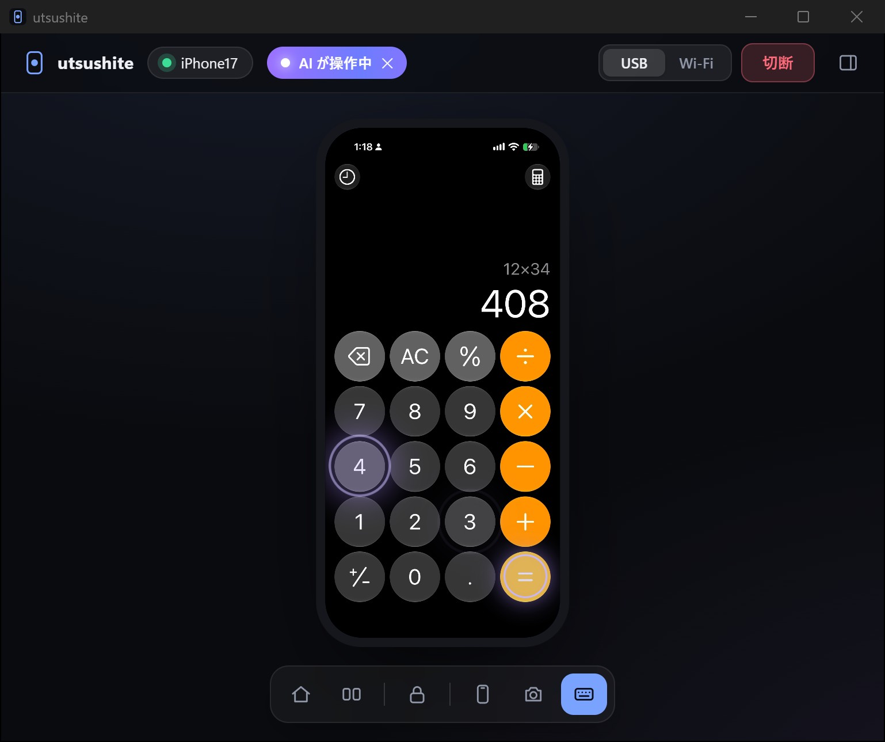
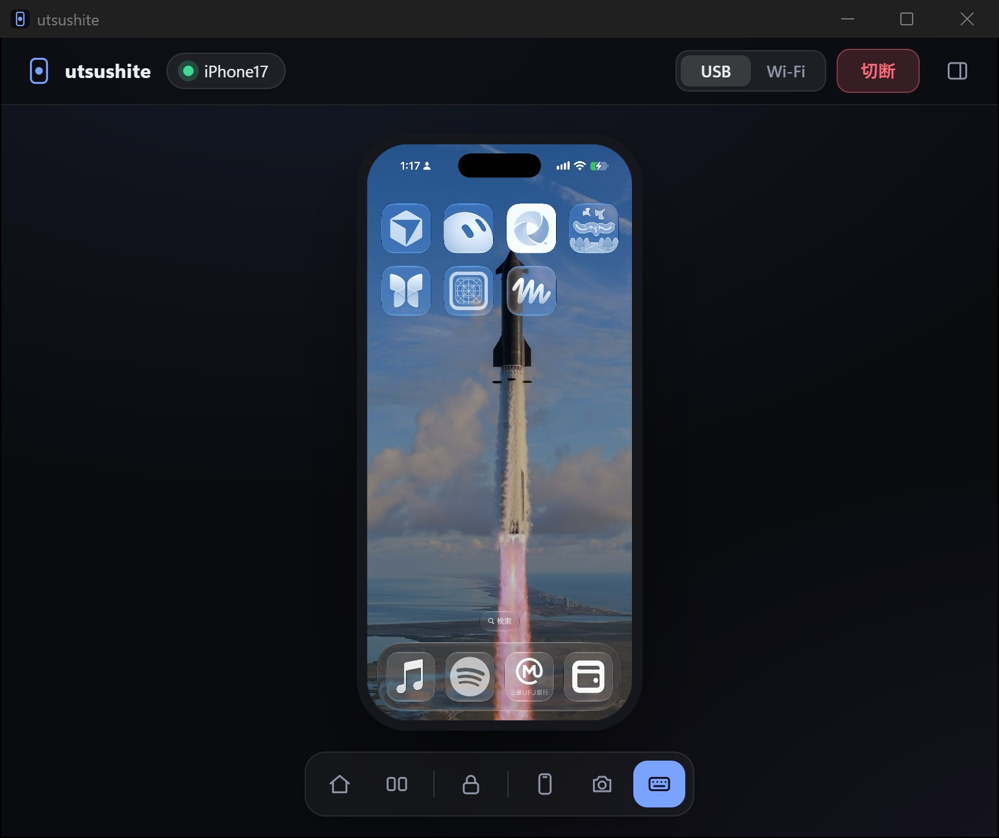

# iCtrl — Windows から iPhone を操作する

日本語 | [English](README.en.md)

パソコンの AI（Claude など）に、iPhone を操作してもらうための道具です。Claude に「iPhone で設定を開いて」のように頼むと、Claude が iPhone を操作します。iPhone の画面はパソコンに映るので、操作の様子を見ながら、自分でもマウスとキーボードで操作できます。USB ケーブルでも、同じ Wi-Fi につないだ状態でも使えます。

| Claude が iPhone の計算機を操作しているところ | iPhone の画面をパソコンに映したところ |
|---|---|
|  |  |

上に「AI が操作中」と表示され、Claude が押した所に紫の点が出ます。

## できること

- iPhone の画面をパソコンに映す（音は出ません）
- クリックでタップ、マウスホイールでスクロール、キーボードで文字を入力する（日本語も入力できます）
- iPhone でコピーした文字や画像をパソコンで貼り付ける。パソコンの文字を iPhone に貼り付ける
- iPhone の画面をパソコンにスクリーンショットとして保存する
- Claude に頼んで、iPhone を操作してもらう

## 用意するもの

| もの | 説明 |
|---|---|
| Windows 10 か 11 のパソコン | Mac では使えません |
| Claude のデスクトップアプリ（または Codex） | iCtrl は Claude Code（アプリの「Code」タブ）か Codex のプラグインとして入れます |
| Apple Devices アプリ | パソコンと iPhone を USB でつなぐために必要です。[Microsoft Store](https://apps.microsoft.com/detail/9np83lwlpz9k) から無料で入れられます（iTunes が入っていれば不要です） |
| iPhone | iOS 17.4 以降。**デベロッパモード** をオンにしておきます（設定 › プライバシーとセキュリティ › デベロッパモード。オンにすると iPhone が再起動します） |
| USB ケーブル | 最初の 1 回だけ使います。2 回目からは Wi-Fi でも接続できます |

Python などのプログラムを自分で入れる必要はありません。iCtrl を最初に起動したときに、必要なものを自動でダウンロードして用意します（約 200MB、20 秒ほど）。

## 入れ方

### Claude のプラグインとして入れる

1. Claude のデスクトップアプリを開き、「Code」タブで新しいセッションを始めます。
2. 次のように頼みます。

   ```
   iCtrl のプラグインを入れて。マーケットプレイスは hinatamaxxx/ictrl、プラグインは ictrl@ictrl。
   ```

   Claude が次の 2 つのコマンドを実行します。自分でターミナルに入力してもかまいません。

   ```bash
   claude plugin marketplace add hinatamaxxx/ictrl
   ```

   ```bash
   claude plugin install ictrl@ictrl
   ```

3. Claude のアプリを再起動します。
4. 新しいセッションで「iCtrl の画面を開いて」と頼みます。アプリの右側のブラウザーに iCtrl の画面が出れば完了です。

### Codex のプラグインとして入れる

Codex でも同じように使えます。Codex に「iCtrl のプラグインを入れて。マーケットプレイスは hinatamaxxx/ictrl、プラグインは ictrl@ictrl。」と頼むか、ターミナルで次の 2 つのコマンドを実行します。

```bash
codex plugin marketplace add hinatamaxxx/ictrl
```

```bash
codex plugin add ictrl@ictrl
```

入れたあとは、新しいスレッドで「iCtrl の画面を開いて」と頼みます。このあとの説明の「Claude」は、Codex に読み替えてください。

このリポジトリが非公開の間は、閲覧できる GitHub アカウントでサインインしているパソコンでだけ入れられます。

### Claude を使わずにアプリとして使う

iCtrl は Claude を使わずに、ふつうの Windows のアプリとしても動きます（スタートメニューから開き、専用のウィンドウで操作します。Python が必要です）。使いたい場合は、Claude Code や Codex などの AI エージェントにこのリポジトリの URL を渡して、「アプリとして導入して」と頼んでください。AI が [AGENTS.md](AGENTS.md) の手順で入れます。

## 初めて iPhone をつなぐ

1. iPhone を USB ケーブルでパソコンにつなぎます。
2. iCtrl の画面で「USB で接続」を押します。
3. iPhone に「このコンピュータを信頼しますか？」と出たら「信頼」を押し、iPhone のパスコードを入力します。
4. iPhone の画面が映れば完了です。

このとき、Wi-Fi で接続するための準備も自動で済みます。2 回目からは、パソコンと iPhone が同じ Wi-Fi にあれば、ケーブルなしで「Wi-Fi で接続」を押すだけで使えます。

## 起動と終了

iCtrl は裏で動く本体（サーバー）と、iPhone を映して操作する画面でできています。サーバーを自分で起動したり止めたりする必要はありません。

- **起動**：Claude に「iCtrl の画面を開いて」と頼むか、iPhone の操作を頼むと、サーバーも自動で起動します。画面は Claude のアプリの右側のブラウザーに出ます。
- **終了**：画面を閉じると 30 秒で iPhone との接続を切り、そのあと 1 分でサーバーも終了します。画面を一時的に隠しただけで接続が切れないよう、少し待ってから切ります。Claude が iCtrl を使っている間は動き続けます。

サーバーだけが動いている間は、タスクバーにも通知領域にもアイコンは出ません。アプリとして入れた場合は、スタートメニューの「iCtrl」で起動し、ウィンドウを閉じるとすぐに終了します。

### サーバーを手動で起動する（詳しい人向け）

ふつうは不要ですが、サーバーをコマンドで起動することもできます。PowerShell で次を実行します。`<バージョン>` には、`%USERPROFILE%\.claude\plugins\cache\ictrl\ictrl\` の中で、いちばん新しいバージョンのフォルダーの名前が入ります。

```powershell
& "$env:USERPROFILE\.claude\plugins\cache\ictrl\ictrl\<バージョン>\plugin\ictrl.cmd" url
```

サーバーが裏で起動し、画面の URL（`http://127.0.0.1:47800/`）が表示されます。アプリとして入れた場合のコマンドは、[技術資料の「セットアップ」](docs/technical.md#セットアップclaude-のプラグインを使わない場合) にあります。

画面はふつうのブラウザーで `http://127.0.0.1:47800/` を開いても使えます。手動で起動したサーバーも、使われていない状態が 1 分続くと自分で終了します。止めるためのコマンドはないので、自動で終了するのを待つか、タスクマネージャーで `pythonw.exe` を終了します。

## ふだんの使い方

1. Claude に「iCtrl の画面を開いて」と頼みます。
2. 画面の上にある「USB」か「Wi-Fi」を選んで接続します。
3. 終わったら「切断」を押すか、画面を閉じます。

| 操作 | やり方 |
|---|---|
| タップ | 画面をクリック |
| スクロール | マウスホイール |
| ホームに戻る | 下のバーの家のボタン、または Ctrl+H |
| アプリの切り替え | 下のバーの切り替えボタン |
| 画面のロック | 下のバーの錠前のボタン |
| 文字の入力 | パソコンのキーボードでそのまま打つ。日本語の変換は iPhone 側で行います（スペースで変換、Enter で確定） |
| 日本語と英字の切り替え | Windows の「あ／A」の切り替え（半角/全角キー）に、iPhone も合わせて切り替わります |
| 貼り付け | Ctrl+V、または右クリックの「貼り付け」 |
| スクリーンショット | Ctrl+S、または下のバーのカメラのボタン。「ピクチャ › iCtrl」に保存されます |
| 画面を映す・止める | 下のバーの iPhone の形のボタン |

iPhone のロックは自分で解除してください。

## Claude に iPhone の操作を頼む

iCtrl を入れた Claude に、たとえば次のように頼みます。

```
iPhone で設定アプリを開いて、Wi-Fi の画面を出して。
```

- Claude は iCtrl を使い始めると、アプリの右側のブラウザーに iCtrl の画面を開きます。iPhone の画面と Claude の操作の様子を、そのまま見ていられます。
- Claude が操作している間は、iCtrl の画面の上に「AI が操作中」と表示され、Claude が触った場所に紫の点が出ます。
- 「AI が操作中」の ✕ を押すと、すぐに止められます。マウスで操作すれば、いつでも自分が引き継げます。
- Claude は iPhone のパスコードを入力しません。

### 補助アプリ（WebDriverAgent）を入れる

Claude は iPhone の画面にあるボタンや文字を読み取って操作します。iPhone に補助アプリ「iCtrl WDA」（WebDriverAgent）を入れておくと、Claude は画面のボタンや文字の種類と位置を一覧で読み取り、画像を見なくても名前を指定して押せます。入れなくても使えます（[Claude が画面を読む方法](#claude-が画面を読む方法)）。

補助アプリは署名していない状態で配布しています。iPhone に入れるときに、自分の Apple ID で署名してください。Apple の仕組みで決まっていることなので、iCtrl では省けません。

1. **ダウンロードする。** [Releases の「iCtrl WDA」](https://github.com/hinatamaxxx/ictrl/releases/tag/wda) から `iCtrl-WDA.ipa` をダウンロードします。
2. **署名して iPhone に入れる。** パソコンに [AltStore Classic](https://altstore.io/)（パソコン側の AltServer と組み合わせて使います）か [Sideloadly](https://sideloadly.io/) を入れ、iPhone を USB でつないで、`iCtrl-WDA.ipa` を自分の Apple ID で入れます（無料の Apple ID でかまいません）。
3. **iPhone で信頼する。** iPhone の 設定 › 一般 › VPN とデバイス管理 で、自分の Apple ID を「信頼」します。
4. Claude に何か操作を頼むと、iCtrl が補助アプリを自動で使います。補助アプリをホーム画面から開く必要はありません。

無料の Apple ID で入れた補助アプリは、7 日で使えなくなります。そのときは、もう一度 2 の手順で入れ直してください（AltStore Classic なら更新の操作だけで済みます）。

補助アプリの初回の起動で iPhone がパスコードを求めることがあります。その場合は iPhone で自分で入力するか、iCtrl のメニューの「WDA のパスコード入力」で設定してください。

`iCtrl-WDA.ipa` は、Appium が公開している WebDriverAgent の配布物から、アプリの ID と表示名だけを変えたものです。WebDriverAgent のライセンス（BSD-3-Clause）の文は、同じ Releases の `WebDriverAgent-LICENSE.txt` にあります。ダウンロードせずに、Claude に「iCtrl の補助アプリの IPA を作って」と頼んで、パソコンの上で同じファイルを作ることもできます（デスクトップにできます）。

### ほかの WebDriverAgent との違い

WebDriverAgent（WDA）は、Appium などの iPhone の自動テストの道具で広く使われているアプリです。iCtrl WDA は Appium の公式の配布物を iCtrl 用に整えたもので、中身の動きは同じです。違うのは次の点です。

- **名前と ID**：ホーム画面での名前を「iCtrl WDA」、アプリの ID を `com.ictrl.wda` にしています。中のプログラムは作り直しておらず、Appium の配布物のままです。
- **使う App ID の数**：Appium の配布物は、アプリと中のテストの部品で ID が 2 つに分かれています。iCtrl WDA は 1 つにまとめているので、無料の Apple ID で入れるときに、作れる App ID の数（7 日に 10 個まで）を 1 つしか使いません。
- **Apple の部品**：Appium の配布物と同じく、Xcode の XCTest などの部品は入っていません。iPhone にある開発用の部品を使います（iOS 17 以降）。
- **動かし方**：iCtrl は、Claude が画面の要素を読むときだけ起動し、終わったら止めます。WDA の通信の入口（ポート 8100）には認証がなく、同じネットワークのほかの機器からも接続できてしまうためです。

ほかのツールで入れた WDA がすでに iPhone にあれば、iCtrl はそれも使えます。iCtrl WDA とほかの WDA の両方があるときは、iCtrl WDA を使います。

### Claude が画面を読む方法

Claude が iPhone の画面を読む方法は、補助アプリの有無と画面の内容で変わります。

- **補助アプリがあるとき**：画面のボタンや文字を一覧で読み取り、名前を指定して押します。画像を送らないので速く、Claude の利用量（トークン）も少なくて済みます。
- **補助アプリがないとき**：iPhone の画面の画像から、Windows の文字認識で文字を読み取って操作します。文字のないアイコンは文字認識では読めないので、Claude が画面の画像を見て位置を判断して押します。

補助アプリを入れていても、次のときは Claude が画面の画像を見て操作します。

- 押したいものが一覧に出てこないとき。たとえば文字のないアイコンや、ゲーム・地図・お絵描きのように画面を絵として描いているアプリです。
- 写真や地図の中身など、画像を見ないと判断できないとき。
- 補助アプリを起動できなかったとき（署名の期限が切れた、信頼していない、など）。このときは、文字認識での読み取りに切り替わります。

## コピーを速くするショートカット

iPhone でコピーした文字をパソコンに速く届けるために、iPhone のショートカット「ictrlcopy」を使います。なくても使えますが、Gmail など一部のアプリでは、コピーしてからパソコンに届くまで 1 分ほどかかります（ictrlcopy があれば約 1 秒）。

ショートカットは Claude に作ってもらえます。Claude が iPhone のショートカット アプリを操作する様子は、iCtrl の画面でそのまま見ていられます。補助アプリ（iCtrl WDA）がなくても作れます（確認済み）。ただし、Claude が画面の画像を見ながら操作するので時間がかかり、押す場所がずれてやり直すこともあります。

```
iCtrl で iPhone を操作して、ショートカット「ictrlcopy」を作って。作り方は https://github.com/hinatamaxxx/ictrl/blob/main/docs/technical.md の「クリップボード連携のしくみ」にあります。
```

自分で作るときは、iPhone のショートカット アプリで次のように作ります。

1. 「新規ショートカット」を押し、右上の「編集」を押します。
2. 下の検索欄で探して、「クリップボードを取得」「入力からテキストを取得」「if文」の順に足します。
3. 「if文」の条件を「任意の値」にし、「の場合」の中に「クリップボードにコピー」（コピーするのは「テキスト」）を入れます。
4. 検索欄で「キーボード」を探して足します（「キーボードが接続されたとき」に動くようになります）。
5. 名前を「ictrlcopy」にします。

iPhone がロックされているときに動かないよう、ictrlcopy の設定で「ロック中に実行を許可」をオフにしておくことをおすすめします。

## 安心して使うために

- iCtrl は USB でつないだ iPhone か、同じ Wi-Fi にある iPhone だけを操作します。外出先からは使えません。
- iCtrl を使っていないときは、iPhone との接続を自動で切ります。自動でつなぎ直すことはありません。切るのは次のときです。
  - Claude が操作を終えたとき。Claude のブラウザーで iCtrl の画面を開いていても切ります（アプリのウィンドウを開いて見ているときは切りません）。
  - 人の操作も Claude の操作もないまま 5 分たったとき。iCtrl の画面を開いていても切ります。
  - iCtrl の画面を閉じるか隠して 30 秒たったとき。
- つないだままにしたいときは、メニューの「使っていなくても接続を続ける（非推奨）」をオンにします。
- 接続がなく、画面も開いていない状態が 1 分続くと、iCtrl 自体も終了します。パソコンの起動時に自動で起動することもありません。
- iCtrl は同じパソコンの中からの操作だけを受け付けます。

## うまくいかないとき

| 困っていること | 確かめること |
|---|---|
| USB で接続できない | Apple Devices アプリが入っているか。ケーブルを挿し直して、iPhone で「信頼」を押したか |
| Wi-Fi で接続できない | 一度 USB で接続したか。パソコンと iPhone が同じ Wi-Fi にあるか |
| 「デベロッパモードを有効にしてください」と出る | iPhone の 設定 › プライバシーとセキュリティ › デベロッパモード をオンにする |
| 画面が映らない | 電話や LINE の通話中、録音中は、iPhone が画面を送りません。終わってから画面の「画面を映す」を押してください |
| Claude が iCtrl を使えない | Claude のアプリを再起動する。初めて使うときは準備に 20 秒ほどかかります |
| AdGuard を使っていて、接続が途中で切れる | AdGuard の localhost のフィルタリングが通信を妨げることがあります。詳しくは [技術資料](docs/technical.md#windows-での通信の落とし穴adguard-など) を見てください |
| 英語を打っていると勝手に日本語になる | 日本語入力に Meltype を使っていると起きます。Windows の日本語入力を Microsoft IME などに切り替えてください（Windows キー + Space） |

記録（ログ）は `%LOCALAPPDATA%\iCtrl\logs\ictrl.log` にあります。

## 更新と削除

- **更新：** Claude に「iCtrl のプラグインを更新して」と頼み、Claude のアプリを再起動します。
- **削除：** Claude に「iCtrl のプラグインを削除して」と頼みます。設定とペアリングの記録はパソコンに残ります。完全に消すときは、`%APPDATA%\iCtrl` と `%LOCALAPPDATA%\iCtrl` の 2 つのフォルダーを削除します。

Codex のプラグインの場合は、ターミナルで次を実行します。

- **更新：** `codex plugin marketplace upgrade ictrl` のあと、`codex plugin add ictrl@ictrl` をもう一度実行し、新しいスレッドを始めます。
- **削除：** `codex plugin remove ictrl@ictrl` を実行します。

アプリとして入れた場合の更新と削除も、AI エージェントに頼めます。

## もっと詳しく

仕組み、REST API、AI 向けのツールの一覧、補助アプリの細かい動き、パスコードの自動入力などは [技術資料](docs/technical.md) にあります。

## ライセンス

iCtrl は [GNU General Public License v3.0 以降](LICENSE)（GPL-3.0-or-later）で公開しています。使っているライブラリのライセンスは [技術資料の「ライセンス」](docs/technical.md#ライセンス) にあります。iPhone、iOS、Xcode は Apple Inc. の商標です。iCtrl は Apple Inc. とは関係がなく、Apple による承認や支援を受けていません。
